# Database schema (ERD)

Maintained by hand from `backend/app/models.py`; the authoritative DDL is the Alembic chain in `backend/migrations/versions/` (`0001` → `0005`). All primary keys are UUIDs; all timestamps are UTC (`DateTime(timezone=True)`). Run `npm run backend:migrate:check` after any model change — it fails if the models and the migrated schema drift.

## Entity-relationship diagram

```mermaid
erDiagram
    USERS ||--o{ AUTH_SESSIONS : "authenticates"
    USERS ||--o{ AUDIT_LOGS : "acts (actor, nullable)"
    USERS ||--o{ PROJECTS : "creates (created_by)"
    USERS ||--o{ PROJECT_MEMBERS : "belongs to"
    PROJECTS ||--o{ PROJECT_MEMBERS : "has"
    USERS ||--o{ TASKS : "creates / is assigned (created_by, assignee_id)"
    PROJECTS ||--o{ TASKS : "contains"
    TASKS ||--o{ TASK_REVIEWS : "reviewed by"
    USERS ||--o{ TASK_REVIEWS : "reviews (reviewer_id)"
    PROJECTS ||--o{ ACTIVITY_LOGS : "log scope"
    TASKS ||--o{ ACTIVITY_LOGS : "log scope (nullable)"
    USERS ||--o{ ACTIVITY_LOGS : "acts (actor, nullable)"
    TASKS ||--o{ COMMENTS : "discussed on"
    USERS ||--o{ COMMENTS : "authors"
    TASKS ||--o{ ATTACHMENTS : "has files"
    USERS ||--o{ ATTACHMENTS : "uploads"
    TASKS ||--o{ GITHUB_LINKS : "has evidence"
    USERS ||--o{ GITHUB_LINKS : "submits"
    USERS ||--o{ NOTIFICATIONS : "receives"
    TASKS ||--o{ NOTIFICATIONS : "about (nullable)"
    PROJECTS ||--o{ NOTIFICATIONS : "about (nullable)"

    USERS {
        uuid id PK
        varchar email UK
        varchar full_name
        varchar role "CHECK ADMIN|MANAGER|MEMBER"
        varchar password_hash
        boolean is_active
        boolean must_change_password
        timestamptz created_at
        timestamptz updated_at
    }
    AUTH_SESSIONS {
        uuid id PK
        uuid user_id FK
        varchar refresh_token_hash UK
        timestamptz created_at
        timestamptz expires_at
        timestamptz revoked_at
    }
    AUDIT_LOGS {
        uuid id PK
        uuid actor_id FK "nullable, SET NULL"
        varchar action
        varchar target_type
        uuid target_id
        json details
        timestamptz created_at
    }
    PROJECTS {
        uuid id PK
        varchar key UK
        varchar name
        varchar description
        varchar status "CHECK PLANNED|ACTIVE|COMPLETED|ARCHIVED"
        date due_date
        uuid created_by FK
        timestamptz created_at
        timestamptz updated_at
    }
    PROJECT_MEMBERS {
        uuid project_id PK "FK"
        uuid user_id PK "FK"
        varchar role "CHECK MANAGER|MEMBER"
        uuid added_by FK
        timestamptz added_at
    }
    TASKS {
        uuid id PK
        uuid project_id FK
        int issue_number "UK (project_id, issue_number)"
        varchar issue_key "UK (project_id, issue_key)"
        varchar title
        text description
        varchar type "CHECK TASK|FEATURE|BUG"
        varchar priority "CHECK LOW|MEDIUM|HIGH|URGENT"
        varchar status "CHECK TODO|IN_PROGRESS|PENDING_REVIEW|CHANGES_REQUIRED|COMPLETED"
        uuid created_by FK
        uuid assignee_id FK "nullable"
        date due_date
        timestamptz completed_at
        timestamptz created_at
        timestamptz updated_at
    }
    TASK_REVIEWS {
        uuid id PK
        uuid task_id FK
        uuid reviewer_id FK
        varchar decision "CHECK APPROVED|CHANGES_REQUIRED"
        varchar feedback
        timestamptz created_at
    }
    ACTIVITY_LOGS {
        uuid id PK
        uuid project_id FK
        uuid task_id FK "nullable"
        uuid actor_id FK "nullable, SET NULL"
        varchar action
        json details
        timestamptz created_at
    }
    COMMENTS {
        uuid id PK
        uuid task_id FK
        uuid author_id FK
        text body
        timestamptz created_at
        timestamptz updated_at
    }
    ATTACHMENTS {
        uuid id PK
        uuid task_id FK
        uuid uploader_id FK
        varchar original_name
        varchar storage_key UK
        varchar content_type "CHECK PNG|JPEG|PDF|DOCX MIME types"
        int size_bytes "CHECK >= 0"
        timestamptz created_at
    }
    GITHUB_LINKS {
        uuid id PK
        uuid task_id FK
        uuid submitted_by FK
        varchar url "CHECK LIKE 'http%'"
        varchar evidence_type "CHECK REPOSITORY|COMMIT|PULL_REQUEST|OTHER"
        timestamptz created_at
    }
    NOTIFICATIONS {
        uuid id PK
        uuid recipient_id FK
        varchar type "CHECK TASK_ASSIGNED|REVIEW_REQUESTED|CHANGES_REQUIRED|TASK_APPROVED|PROJECT_ADDED"
        uuid task_id FK "nullable"
        uuid project_id FK "nullable"
        boolean is_read
        timestamptz read_at
        timestamptz created_at
    }
```

## Referential actions

| Relationship | On delete |
|---|---|
| `auth_sessions.user_id → users.id` | CASCADE |
| `audit_logs.actor_id → users.id` | SET NULL |
| `activity_logs.actor_id → users.id` | SET NULL |
| `activity_logs.project_id / task_id` | CASCADE |
| `projects.created_by → users.id` | RESTRICT |
| `project_members.project_id → projects.id` | CASCADE |
| `project_members.user_id / added_by → users.id` | RESTRICT |
| `tasks.project_id → projects.id` | CASCADE |
| `tasks.created_by / assignee_id → users.id` | RESTRICT |
| `task_reviews.task_id → tasks.id` | CASCADE |
| `task_reviews.reviewer_id → users.id` | RESTRICT |
| `comments.task_id → tasks.id` | CASCADE |
| `comments.author_id → users.id` | RESTRICT |
| `attachments.task_id → tasks.id` | CASCADE |
| `attachments.uploader_id → users.id` | RESTRICT |
| `github_links.task_id → tasks.id` | CASCADE |
| `github_links.submitted_by → users.id` | RESTRICT |
| `notifications.recipient_id → users.id` | CASCADE |
| `notifications.task_id / project_id` | CASCADE |

## Notes

- **Progress (SRS §3.11)** is computed, not stored: `completed tasks / total tasks × 100`, `0` when the project has no tasks. See `project_progress()` in `backend/app/api/projects.py`.
- **Log retention**: `audit_logs` are kept indefinitely; `activity_logs` have a 180-day retention window. See `docs/adr/0002-log-retention-policy.md`.
- **Indexes** cover every foreign key and lookup column (`email`, `key`, `refresh_token_hash`, `storage_key`, `tasks.status`, and all FK columns).
